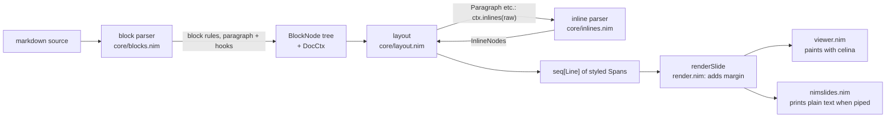

# nimslides architecture

How markdown becomes a slide, and how to add one markdown feature without
touching anything else.

## Pipeline



1. **Blocks.** The source is split into lines (tabs expanded to 4-column
   stops). At each non-blank line, block rules are tried in priority order;
   if none matches, core's **paragraph** takes the line plus following lines.
2. **Inlines are parsed during layout**, not during block parsing, so
   document state collected anywhere in the document (e.g. link reference
   definitions) is complete by then.
3. **Layout** turns each block into lines at a given width; blocks are
   separated by one blank line. Inline nodes produce spans; `wrap` breaks
   them into lines.

## Modules

| Module | Responsibility |
|---|---|
| `core/types.nim` | `Color`, `Style`, `Span`, `Line`, `Slide`, `plain`, `merge` |
| `core/width.nim` | display width and grapheme clusters; a copy of celina's logic, checked against celina in `tests/test_layout.nim` |
| `core/ast.nim` | open node types `BlockNode`, `InlineNode` with base methods; core's `Paragraph` and `Text`; `DocCtx`, `LayoutCtx` |
| `core/registry.nim` | rule types, `register*` procs, `defaultStyle`, `ctx.style(key)` |
| `core/blocks.nim` | `BlockParser` cursor, paragraph fallback with hooks, `parseBlocks` |
| `core/inlines.nim` | text, backslash escapes, soft breaks, rule dispatch, delimiter-run matching |
| `core/layout.nim` | `wrap`, `ctx.inlines`, `layoutBlocks`, `ctx.renderBlocks`, paragraph layout |
| `core/discover.nim` | `importAll(dir)`: compile-time import of every `.nim` file in a folder |
| `core.nim` | re-exports core; `renderDocument(src, width)`. **Features import only this.** |
| `features.nim` | `importAll("features")`; nothing to edit when adding a feature |
| `features/<name>.nim` | one markdown feature each |
| `render.nim` | `renderSlide` = `renderDocument` + `margin`; re-exports `core/types` |
| `viewer.nim` | the only module that imports celina |

Rules: features never import each other, never import celina, and never
import anything of nimslides but `../core`.

## One feature = three files

A feature task creates or changes only:

- `src/nimslides/features/<name>.nim`
- `tests/features/test_<name>.nim`
- `examples/features/<name>.md`

Nothing else: no list to register in, no core edits. If a feature seems to
need a core change (a new hook, a helper several features share, a change to
paragraphs or wrapping), stop and ask for it as a **separate core task**.
Core changes are done one at a time, never in parallel with each other.

## Feature file template

The file name is the feature name (a valid Nim identifier, e.g.
`thematic_break.nim`). Example with made-up syntax:

```nim
## Notes: a line starting with "NOTE:" shown dimmed, and @mentions in bold.

import std/strutils
import ../core

type
  Note* = ref object of BlockNode # export node types so tests can inspect them
    raw*: string
  Mention* = ref object of InlineNode
    name*: string

method layout(node: Note, ctx: LayoutCtx): seq[Line] =
  wrap(ctx.inlines(node.raw, ctx.style("note")), ctx.width)

method spans(node: Mention, ctx: LayoutCtx, base: Style): seq[Span] =
  @[Span(text: "@" & node.name, style: base.merge(ctx.style("note.mention")))]

registerBlock BlockRule(
  name: "note",
  priority: 95,
  interruptsParagraph: false,
  parse: proc(p: BlockParser): BlockNode =
    if p.line.startsWith("NOTE:"): # nil = no match; core restores p.pos
      result = Note(raw: p.line[5 .. ^1].strip)
      p.advance,
)

registerInline InlineRule(
  name: "mention",
  triggers: {'@'},
  priority: 95,
  parse: proc(p: InlineParser): InlineNode =
    var i = p.pos + 1
    while i < p.src.len and p.src[i] in IdentChars:
      inc i
    if i > p.pos + 1:
      result = Mention(name: p.src[p.pos + 1 ..< i])
      p.pos = i,
)

defaultStyle("note", Style(dim: true))
defaultStyle("note.mention", Style(bold: true))
```

What a feature file must contain:

- `import ../core` (plus `std/` modules it needs). Nothing else is required:
  no `{.used.}`, no export list. `features.nim` silences "imported and not
  used" for the feature modules themselves.
- Node types inheriting `BlockNode` / `InlineNode`, each overriding exactly
  one of these, at top level (a missing override raises at runtime):
  - `method layout(node: X, ctx: LayoutCtx): seq[Line]` — lines at most
    `ctx.width` columns wide
  - `method spans(node: X, ctx: LayoutCtx, base: Style): seq[Span]` —
    `base` is the style of the enclosing nodes; `merge` your style on top.
    A span may contain `"\n"` to force a line break (hard line breaks).
- `register*` calls and `defaultStyle` calls at module top level.

### Core API

```nim
# blocks (core/registry.nim, core/blocks.nim)
registerBlock(BlockRule(name, priority, interruptsParagraph, parse: proc(p: BlockParser): BlockNode))
registerParagraphCloser(ParagraphCloser(name, priority, close: proc(p: BlockParser): ParagraphBuild))
registerParagraphStart(ParagraphStart(name, priority, consume: proc(lines: seq[string], doc: DocCtx): int))
type ParagraphBuild = proc(lines: seq[string]): BlockNode
p.line; p.peek(offset); p.advance(n); p.eof; p.pos; p.lines; p.doc
p.takeWhile(pred); p.interrupting; p.interruptsParagraph()
p.parseBlocks(lines)        # containers: parse inner lines, shares doc
isBlank(line); indentOf(line); expandTabs(line)

# inlines (core/registry.nim, core/inlines.nim)
registerInline(InlineRule(name, triggers: set[char], priority, parse: proc(p: InlineParser): InlineNode))
registerDelimiter(DelimiterRule(name, ch, intraword, ruleOf3, sameLength, maxRun,
                                build: proc(count: int, children: seq[InlineNode]): InlineNode))
p.src; p.pos; p.peek(offset): char; p.doc; p.parseInlines(text)  # nested content, e.g. link labels
asciiPunctuation

# layout (core/layout.nim, core/ast.nim)
ctx.width; ctx.depth; ctx.doc; ctx.style(key)
ctx.inlines(raw, base): seq[Span]
wrap(spans, width): seq[Line]
ctx.renderBlocks(children, width, gap = 1): seq[Line]   # containers
nodes.spans(ctx, base)                                   # children of an inline node
doc.state("<feature>", MyState)   # per-feature document state, MyState = ref object of RootObj
Text(text: "...")                 # core's literal text node
```

Contract details:

- **Rule procs** return `nil` for "no match"; core restores the cursor. On a
  match they must advance past what they took.
- **Block rules** are called on non-blank lines. When core checks whether a
  line interrupts a paragraph it calls the rules with
  `interruptsParagraph = true` with `p.interrupting = true` and discards the
  result; such calls must not change `p.doc`. Use the flag for conditional
  interruption (an ordered list must start at 1, an empty list item cannot
  interrupt, only some HTML blocks can).
- **Paragraph closer** (setext headings): checked on every line after a
  paragraph's first, *before* the interruption check. Return a builder and
  advance past the underline. Builders receive the paragraph's lines with
  leading whitespace stripped, after start hooks ran.
- **Paragraph start hook** (link reference definitions): runs on a finished
  paragraph's lines, returns how many leading lines it consumed and stores
  what it found with `doc.state(...)`. If nothing is left, the paragraph
  disappears, and a closer's line is parsed again (`[a]: /u` + `===` gives
  a paragraph `===`, as in CommonMark).
- **Delimiters**: core does all of CommonMark's delimiter-run work (left/right
  flanking, `_` intraword rules via `intraword = false`, rule of 3 via
  `ruleOf3`, nesting). The feature only builds the node: `count` is how many
  delimiters were matched (1 or 2 for `*`/`_`; with `sameLength` the whole
  run). For GFM strikethrough use `ch: '~', intraword: true,
  sameLength: true, maxRun: 2`. One rule per character.
- **Escapes**: core turns `\` + ASCII punctuation into literal text, unless
  an inline rule on `\` matched first (hard line break `\` + newline).
  Soft line breaks become one space; trailing spaces before them are
  dropped, so a hard-break rule must trigger on `' '` and match `"  \n"`.
- Code spans, autolinks and HTML take their text before delimiters see it:
  inline rules run at their trigger before core's delimiter scanning.

## Priorities

Smaller numbers run first; ties are broken by rule name, so import order
never matters. Delimiter rules have no priority: inline rules on the same
character run before delimiter scanning.

### Blocks (`registerBlock`)

| Prio | Feature (file) | Interrupts a paragraph |
|---:|---|---|
| 10 | indented code (`code_indented`) | no |
| 20 | fenced code (`code_fenced`) | yes |
| 30 | ATX heading (`heading`) | yes |
| 40 | thematic break (`thematic_break`) | yes |
| 50 | blockquote (`blockquote`) | yes |
| 60 | list: bullet, ordered, task (`list`) | yes, conditionally (`p.interrupting`): not an empty item, ordered only from 1 |
| 70 | HTML block / comment (`html`) | yes for comments and known tags (CommonMark types 1-6), not type 7 |
| 80 | table (`table`) | no |
| — | paragraph | core fallback |

Paragraph hooks:

| Prio | Hook | Feature |
|---:|---|---|
| 10 | closer: setext heading (`===` / `---` under a paragraph) | `heading` |
| 10 | start: link reference definitions, stored in `doc.state("links", ...)` | `links` |

The `-` conflicts are resolved by this order: under a paragraph line, `---`
is a **setext heading** (closers run before interruption checks); elsewhere
`---`, `***`, `- - -` are a **thematic break** (40) before a **list item**
(60) is tried; `- item` is a list. Later, `---` on its own line will also
become the **slide separator**. Slides will be split before block parsing,
as a core task, so the thematic break feature should not rely on `---`
reaching it.

### Inlines

| Prio | Feature (file) | Mechanism | Triggers |
|---:|---|---|---|
| 10 | code span (`code_span`) | `registerInline` | `` ` `` |
| 20 | autolink (`links`) | `registerInline` | `<` |
| 30 | inline HTML (`html_inline`) | `registerInline` | `<` |
| 40 | image (`image`) | `registerInline` | `!` |
| 50 | link: inline, reference (`links`) | `registerInline` | `[` |
| 60 | hard line break (`hard_break`) | `registerInline` | `' '`, `\` |
| — | emphasis / strong (`emphasis`) | `registerDelimiter` | `*`, `_` |
| — | strikethrough (`strikethrough`) | `registerDelimiter` | `~` |

Links and images share label and destination parsing. Features cannot import
each other, so either handle images inside `links.nim` or first move the
shared parsing into core as a separate core task. Decide before starting
either feature.

## Style keys

`defaultStyle("<feature>", style)` or `defaultStyle("<feature>.<element>",
style)`, where `<feature>` is the file name: `heading.1` … `heading.6`,
`emphasis`, `strong`, `strikethrough`, `code_span`, `code_fenced`,
`blockquote.bar`, `list.bullet`, `links.text`, `links.url`, `table.border`,
`thematic_break`. Core owns `paragraph`. Look styles up with
`ctx.style(key)`: a theme override, else the default, else plain.
Registering a key twice fails at startup.

## Testing a feature

`tests/features/test_<name>.nim`:

```nim
import std/unittest
import ../helpers
import nimslides/features/note # only this feature is registered

suite "note":
  test "renders dimmed":
    check render("NOTE: hi") == @["hi"]
    check styleOf("NOTE: hi", "hi") == Style(dim: true)
    check parse("NOTE: hi")[0] of Note

  test "the example renders":
    check render(example("note"), 40).len > 0
```

`tests/helpers.nim` imports core only, so a feature test runs with just its
own feature (import others explicitly to test interplay):

- `render(md, width = 40): seq[string]` — plain lines, no slide margin,
  `""` between blocks
- `styled(md, width = 40): seq[Line]` — the same with styles
- `styleOf(md, text): Style` — style of the first span containing `text`
- `parse(md): seq[BlockNode]`, `parseInline(raw): seq[InlineNode]` — nodes to
  inspect with `of` and conversions
- `example(name)` — contents of `examples/features/<name>.md`

`examples/features/<name>.md` shows every case of the feature; `examples/showcase.md`
uses all features together. Check by eye with
`COLUMNS=60 ./nimslides examples/features/<name>.md` and in the viewer.

Run everything with `nimble test` (runs `tests/test_*.nim` and
`tests/features/test_*.nim`). Core tests that register test-only rules use
`let empty = snapshot()` and `restore empty` in `setup`.

## Dependencies and Nix

Prefer no new dependencies. If one is needed: add it to `nimslides.nimble`,
then regenerate the lock **inside the dev shell**:
`nix develop -c nim_lk > lock.json`. Never `nix run nixpkgs#nim_lk`: it is
unpatched and locks wrong revisions of `v`-prefixed tags. The Nix source is
`nimslides.nimble` plus every `.nim` under `src/`; new files must be added to
git (`git add`) before `nix build` sees them.

## Interactive regions (planned, not built)

- `Slide` gains `regions: seq[Region]`; a region has the rows it covers, a
  kind (e.g. `collapsible`) and state (e.g. `expanded`), plus an id stable
  across re-renders.
- Features describe what is interactive, never how it is drawn: e.g. a
  fenced code block's layout reports "rows 3-12, collapsible, collapsed
  shows 3 rows". `LayoutCtx` will carry the state per region id so layout
  produces the collapsed or expanded lines, and a way to report regions
  (row offsets are fixed up as containers stack their children).
- `viewer.nim` maps regions to celina widgets/key handling (focus, toggle),
  updates the state and re-renders the slide.
- Markdown features never import celina; this needs a core task (types,
  context, layout bookkeeping) before any feature uses it.
